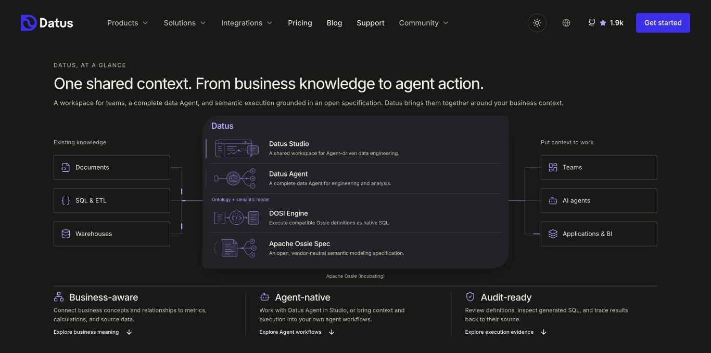
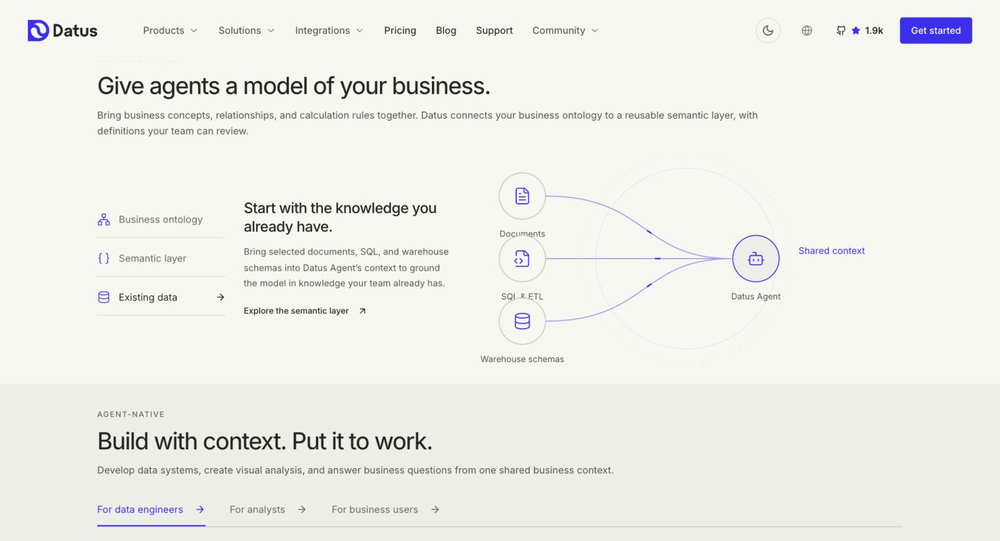
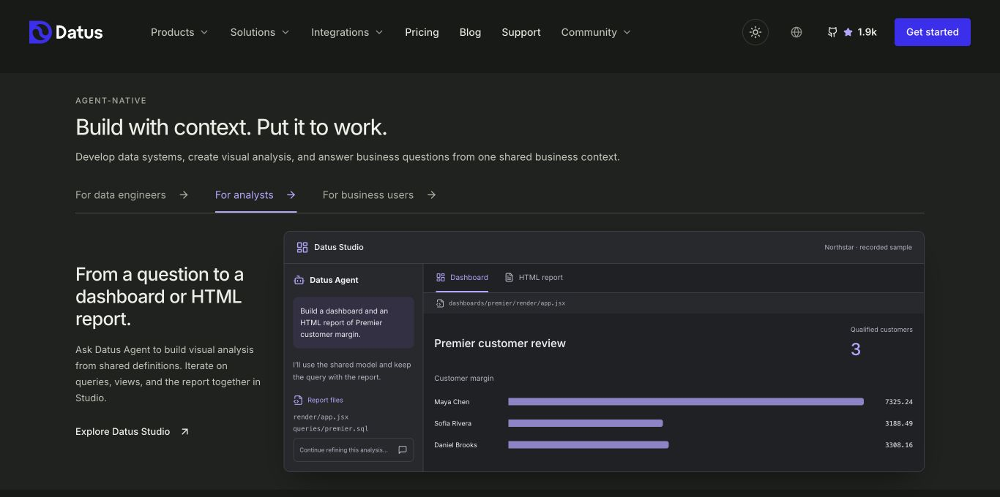
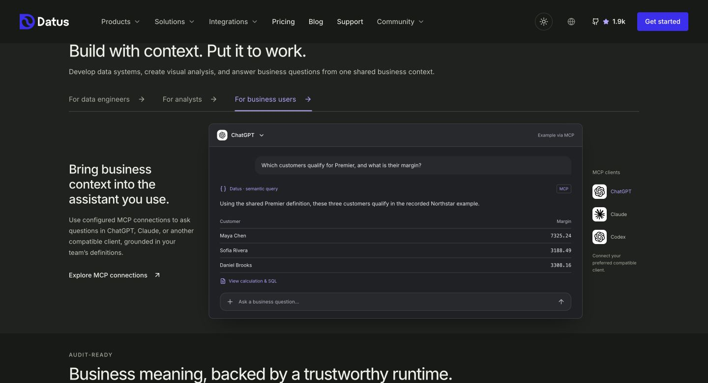

# Homepage design review — 23 October 2026

This is the current homepage design on the source branch of PR #94. These
captures are review material; the website renders interactive components rather
than these screenshots. The standalone visual identity project stays separate.

## What changed

- Position Datus as open data context for AI agents, with one overall product
  architecture followed by Business-aware, Agent-native and Audit-ready.
- Show rich Ossie definitions and eight connected Northstar business concepts.
- Present three usage paths: data engineers working with Datus Agent in Studio;
  analysts building dashboards and HTML reports; and business users analysing
  through configured MCP clients.
- Keep the five-step animated context workflow, explain the open Ossie
  specification and compatible DOSI runtime, and place the main CTA before FAQ
  and the latest resources.
- Default to dark while preserving the light option; keep English and Chinese
  pages, keyboard navigation and reduced-motion support.

## Architecture and three foundations

## Rich semantic definitions

## Analyst workflow

## Business-user workflow

Product fragments adapt existing product source and recorded Northstar demo
artifacts. The client illustration is not a live ChatGPT or Claude session;
preview approvals and queries do not change a real repository or database.

## Run the interactive review

Follow `DEVELOPMENT.md`: install dependencies, run `npm run build:all`, then
`npm run preview`. Review `/` and `/zh/`, including both themes.

Production build, bilingual prerender, focused TypeScript checks, default-theme
tests and whitespace checks passed. Browser review covered common laptop sizes
and 320/390px mobile widths; no document-width overflow or captured console
warnings/errors was found in the final audience checks. Previous UI compositions
remain available through `docs/interactive-preview-library.md`.

Publishing this branch updates the PR. The current GitHub Pages workflow deploys
only `main`; it does not provide a branch-preview URL.
